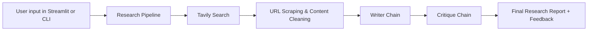

# Langchain Multi-Agent Research System

A lightweight research automation project built with LangChain and Streamlit for gathering web information, extracting article content, and generating structured research reports with a built-in critique layer.

This project is designed to simulate a research workflow where a search step finds relevant sources, a scraping step extracts clean content, and an LLM synthesizes the findings into a professional report while also evaluating the quality of the output.

## Features

- Web search using Tavily
- Automated URL scraping and article extraction
- Research report generation with LangChain prompt chains
- Built-in critique/evaluation of the generated output
- Simple Streamlit UI for interactive use
- CLI-friendly execution for quick testing

## Tech Stack

- Python 3.11
- LangChain
- LangGraph
- OpenAI API via LangChain
- Tavily Search API
- Streamlit
- BeautifulSoup
- readability-lxml
- trafilatura
- requests
- python-dotenv

## Installation

### 1. Clone the repository

```bash
git clone https://github.com/your-username/Langchain-MultiAgentResearchSystem.git
cd Langchain-MultiAgentResearchSystem
```

### 2. Create and activate a virtual environment

Using conda:

```bash
conda create -n multiagent python=3.11 -y
conda activate multiagent
```

Or using venv:

```bash
python -m venv .venv
source .venv/bin/activate
```

### 3. Install dependencies

```bash
pip install -r requirements.txt
```

### 4. Configure environment variables

Create a `.env` file in the project root and add your API keys:

```env
OPENAI_API_KEY=your_openai_api_key
TAVILY_API_KEY=your_tavily_api_key
```

> The app depends on both OpenAI and Tavily to perform searching, scraping, and report generation.

## Running the Project

### Streamlit app

```bash
streamlit run app.py
```

This launches the interactive research interface in the browser.

### Python script demo

```bash
python main.py
```

This runs a sample research workflow for a demo topic and prints the final report plus critique.

## Project Structure

```text
Langchain-MultiAgentResearchSystem/
├── app.py                     # Streamlit front-end
├── main.py                    # Example script runner
├── requirements.txt           # Python dependencies
├── .env                       # Local environment variables (not committed)
├── README.md                  # Project documentation
├── src/
│   ├── __init__.py
│   ├── agents/
│   │   ├── __init__.py
│   │   └── agents.py          # LLM chains and agent setup
│   ├── pipelines/
│   │   ├── __init__.py
│   │   └── pipelines.py       # Research orchestration pipeline
│   └── tools/
│       ├── __init__.py
│       └── tools.py           # Search and scraping utilities
```

## Brief Architecture



### Workflow

1. The user provides a research topic.
2. The pipeline searches the web using Tavily.
3. Each search result is scraped and cleaned to extract readable article content.
4. The collected research is passed into a writing chain that generates a structured report.
5. A separate critique chain reviews the report and scores it with constructive feedback.
6. The output is returned to the user in the interface or terminal.

## How It Works

The architecture is intentionally simple and modular:

- `src/tools/tools.py` handles search and URL extraction.
- `src/agents/agents.py` configures the LLM-based prompt chains used for writing and evaluation.
- `src/pipelines/pipelines.py` coordinates the full research process.
- `app.py` provides a user-facing UI using Streamlit.

## Example Use Cases

- Market research summaries
- Literature and trend reviews
- Topic exploration with source-backed reports
- Quick AI-assisted research drafts

## License

This project is available under the MIT License. See the LICENSE file for details.

## Contributing

Contributions are welcome. If you want to improve the research flow, add more tools, improve scraping quality, or enhance the UI, please open an issue or submit a pull request.

## Notes

This project is best suited for experimentation and learning. For production-grade research systems, you may want to add:

- caching and rate limiting
- validation against trusted source quality
- richer agent orchestration
- structured storage for reports and citations
- more robust search and extraction fallbacks
